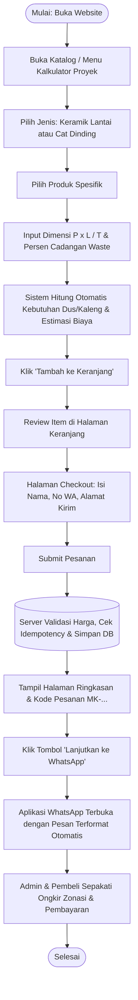
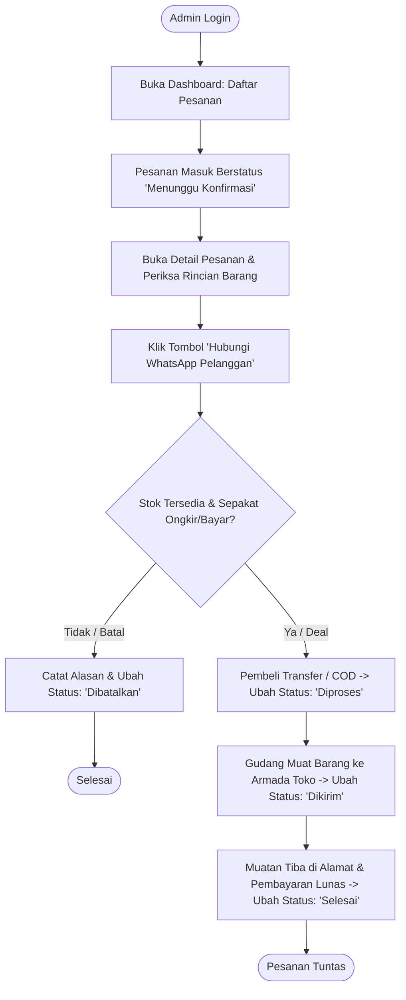
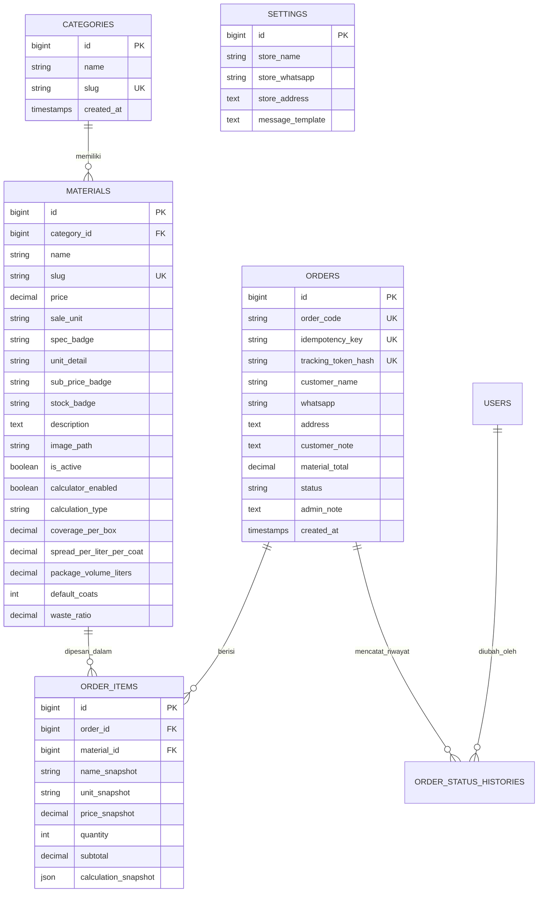

# Product Requirements Document (PRD)
# MATERIALKU — Web Pemesanan Produk Material Bangunan

---

| Informasi Dokumen | Detail |
| :--- | :--- |
| **Nama Proyek / Aplikasi** | **MATERIALKU** |
| **Nama Berkas** | `PRD.md` |
| **Versi Dokumen** | 1.2 (Final Implementasi) |
| **Mata Kuliah** | Pemrograman Web 2 |
| **Target Mitra** | Toko Material Bangunan Lokal (TB. Mandiri Sejahtera Abadi, Bandar Lampung) |
| **Tumpukan Teknologi** | Laravel 12, Inertia.js v2, Vue.js 3, Tailwind CSS, MySQL (Port 3307) |
| **Tanggal Pembaruan** | 18 November 2026 |

---

## 1. Latar Belakang dan Permasalahan yang Ingin Diselesaikan

### 1.1 Latar Belakang
Toko material bahan bangunan mandiri (skala UMKM) memegang peranan krusial dalam rantai pasok pembangunan rumah tinggal dan renovasi masyarakat lokal. Namun, operasional transaksi pemesanan pada umumnya masih mengandalkan cara konvensional, yaitu pelanggan datang langsung ke toko fisik atau memesan via obrolan teks (WhatsApp) tanpa format terstruktur.

Karakteristik bahan bangunan yang memiliki spesifikasi teknis (seperti daya sebar cat per liter, atau luas keping keramik per dus) sering kali membingungkan pelanggan awam saat hendak membeli. Hal ini memicu proses tanya-jawab yang panjang, salah estimasi jumlah pembelian, hingga ketidakpastian ongkos kirim armada muatan berat.

### 1.2 Permasalahan yang Ingin Diselesaikan
Berdasarkan analisis kebutuhan lapangan, ditemukan beberapa permasalahan spesifik:

1. **Kesulitan Konversi Satuan Fisik ke Satuan Beli:**
   Pelanggan mengetahui ukuran fisik ruangan mereka (misal: lantai $4\times 3\text{ meter}$ atau dinding $30\text{ m}^2$), namun kesulitan menghitung berapa dus keramik atau berapa kaleng cat yang harus dibeli, termasuk memperhitungkan toleransi sisa potongan (*waste margin*).
2. **Pemesanan via Chat WhatsApp yang Tercecer dan Tidak Terstruktur:**
   Pemesanan manual via WhatsApp sering tidak menyertakan rincian lengkap (nama, alamat proyek, jenis spesifikasi barang), sehingga admin harus menanyakan berulang-ulang dan riwayat pesanan rawan tercecer atau hilang.
3. **Ketidakpastian Tarif Pengiriman Muatan Berat:**
   Barang material memiliki bobot tonase besar sehingga pengiriman menggunakan armada toko (pickup / truk engkel). Pelanggan sering ragu memesan karena tidak ada transparansi biaya ongkos kirim berdasarkan jarak pangkalan gudang.
4. **Hambatan Registrasi Akun yang Berbelit-belit:**
   Banyak aplikasi toko online mewajibkan pendaftaran akun dan verifikasi email yang panjang. Untuk pembeli bahan bangunan (tukang, kontraktor, pemilik rumah), proses ini memperlambat transaksi (*friction* tinggi).
5. **Kompleksitas Payment Gateway untuk UMKM:**
   Integrasi pembayaran otomatis memotong margin laba UMKM melalui biaya admin pihak ketiga, padahal toko bangunan lokal terbiasa dengan fleksibilitas pembayaran transfer langsung atau bayar di tempat (COD) setelah barang siap diantar.

---

## 2. Tujuan dan Deskripsi Aplikasi

### 2.1 Deskripsi Aplikasi
**MATERIALKU** adalah aplikasi web pemesanan produk bahan bangunan mandiri yang terintegrasi dengan **Kalkulator Estimasi Proyek** dan sistem konfirmasi pesanan terstruktur via **WhatsApp**. 

Sistem ini memudahkan pelanggan untuk mencari material, menghitung kebutuhan riil ruangan fisik secara akurat, memasukkan hasil ke keranjang, dan mengajukan pesanan secara instan tanpa perlu mendaftar akun (*Zero-Friction Guest Checkout*). Seluruh data pesanan divalidasi dan disimpan secara aman ke database server sebelum diteruskan ke WhatsApp admin toko untuk kesepakatan pengiriman dan pembayaran.

### 2.2 Tujuan Aplikasi
1. **Otomasi Estimasi Belanja:** Membantu pelanggan mengonversi luas fisik pekerjaan bangunan menjadi jumlah kemasan jual resmi (*dus* atau *kaleng*) secara matematis dan transparan.
2. **Standardisasi Alur Pemesanan:** Menghasilkan ringkasan pesanan resmi dengan kode unik (`MK-YYYYMMDD-XXXX`) dan format pesan WhatsApp otomatis.
3. **Penyimpanan Terpusat bagi Toko:** Mencatat seluruh transaksi masuk ke dalam database server (*atomic database transaction*) sehingga toko memiliki arsip digital dan audit trail yang rapi.
4. **Transparansi Logistik Lokal:** Menyajikan simulasi cek ongkir per kecamatan berbasis sistem zonasi wilayah radius pangkalan gudang di Bandar Lampung tanpa membebani sistem dengan pelacakan GPS armada yang rumit.

---

## 3. Target Pengguna Aplikasi

Aplikasi ini melayani dua persona pengguna utama:

### 3.1 Pelanggan (Customer / End User)
* **Karakteristik:** Pemilik rumah yang sedang merenovasi hunian, tukang bangunan mandiri, atau mandor proyek skala kecil–menengah.
* **Kebutuhan:** 
  - Ingin cepat mengetahui estimasi bahan bangunan yang harus dibeli tanpa rumus rumit.
  - Ingin memesan langsung tanpa harus registrasi/login yang berbelit.
  - Ingin kejelasan estimasi ongkos kirim ke lokasi proyek mereka.
  - Ingin kemudahan berkomunikasi langsung dengan penjual lewat WhatsApp.

### 3.2 Administrator Toko (Store Admin)
* **Karakteristik:** Pemilik toko bangunan atau staf admin operasional toko bahan bangunan (TB. Mandiri Sejahtera Abadi).
* **Kebutuhan:**
  - Menerima pesanan pelanggan dalam format teks terstruktur yang langsung memuat nama, alamat, nomor telepon, dan rincian item.
  - Memiliki dashboard untuk memantau pesanan masuk dan mengubah status transaksi (*Menunggu Konfirmasi $\rightarrow$ Diproses $\rightarrow$ Dikirim $\rightarrow$ Selesai*).
  - Mengelola data master katalog material, harga resmi, dan parameter kalkulator.
  - Memiliki tombol cepat untuk langsung membalas/menghubungi WhatsApp pemesan.

---

## 4. Identifikasi Kebutuhan dan Fitur Utama

### 4.1 Fitur Utama

```
                           FITUR UTAMA MATERIALKU
┌─────────────────────────────────┬─────────────────────────────────┐
│        SISI PELANGGAN           │           SISI ADMIN            │
├─────────────────────────────────┼─────────────────────────────────┤
│ 1. Katalog & Filter Lanjutan    │ 1. Autentikasi Admin Aman       │
│ 2. Live Search Autocomplete     │ 2. Dashboard Statistik Pesanan  │
│ 3. Kalkulator Keramik & Cat     │ 3. Manajemen Status Pesanan     │
│ 4. Keranjang Belanja Dinamis    │ 4. Quick WhatsApp Chat Action   │
│ 5. Guest Checkout & Anti-Hack   │ 5. Pengelolaan Katalog & Harga  │
│ 6. Ringkasan Pesanan & Tautan WA│ 6. Konfigurasi Kontak Toko      │
│ 7. Simulasi Zonasi Cek Ongkir   │                                 │
└─────────────────────────────────┴─────────────────────────────────┘
```

1. **Katalog Material & Filter Lanjutan:**
   Menampilkan produk dengan foto resolusi tajam, harga resmi, satuan jual, badge spesifikasi teknis, badge ketersediaan (*Ready Stock*), filter multi-kategori, rentang harga (min-max), dan pengurutan (*sorting*).
2. **Pencarian Cepat Live Autocomplete:**
   Input pencarian di header dengan mekanisme *debounce* (300 ms) yang menyajikan dropdown rekomendasi produk secara instan tanpa me-reload halaman.
3. **Kalkulator Kebutuhan Material (Keramik & Cat):**
   - **Keramik:** Menghitung luas ruangan ($P \times L$), penambahan toleransi *waste margin* (default 10%), pembagian dengan cakupan dus $\text{m}^2$, dan pembulatan ke atas (*ceiling*) ke jumlah dus utuh.
   - **Cat Tembok:** Menghitung luas dinding ($P \times T$), dikurangi luas bukaan jendela/pintu, dikalikan jumlah lapisan pengecatan (*coats*), dibagi daya sebar cat, dan dibulatkan ke jumlah kaleng utuh.
   - Hasil kalkulator dapat langsung ditambahkan ke keranjang belanja dengan 1 klik.
4. **Keranjang Belanja Reaktif (Cart):**
   Mendukung penambahan item, pengubahan kuantitas, penghapusan item, dan kalkulasi subtotal otomatis secara real-time di browser.
5. **Checkout Tamu dengan Validasi Harga Server (Anti-Manipulasi):**
   Pelanggan cukup memasukkan Nama, WhatsApp, Alamat Pengiriman, dan Catatan. Sistem server menghitung ulang harga dari database master (*server price enforcement*) guna mencegah manipulasi harga dari inspect element browser.
6. **Integrasi WhatsApp Click-to-Chat:**
   Menghasilkan tautan resmi `https://wa.me/{nomor}?text=...` dengan format pesan rapi yang memuat kode pesanan, rincian barang, total biaya, dan alamat pengiriman.
7. **Informasi Pengiriman & Zonasi Wilayah (Alternatif Fitur Armada):**
   Tabel skema tarif zonasi jarak pangkalan gudang toko (Zona 1 s/d Zona 3 Lampung dan Luar Kota) serta widget simulasi dropdown kecamatan untuk cek estimasi ongkir armada pickup vs truk engkel.

---

## 5. User Flow atau Alur Penggunaan Aplikasi

### 5.1 Diagram Alur Pembelian dengan Kalkulator & WhatsApp


### 5.2 Diagram Alur Pemrosesan Pesanan oleh Admin Toko


---

## 6. Kebutuhan Fungsional dan Nonfungsional

### 6.1 Kebutuhan Fungsional (Functional Requirements)

| Modul | ID | Deskripsi Kebutuhan | Prioritas |
| :--- | :--- | :--- | :---: |
| **Katalog** | `PUB-01` | Menampilkan produk aktif: foto, nama, kategori, harga, satuan jual, spesifikasi, dan badge stok. | **Wajib** |
| **Katalog** | `PUB-02` | Live search autocomplete di header bar dengan debounce 300 ms. | **Wajib** |
| **Katalog** | `PUB-03` | Filter multi-kategori, rentang harga minimum-maksimum, dan status ketersediaan (*Ready Stock*). | **Wajib** |
| **Katalog** | `PUB-04` | Halaman detail produk dengan rincian teknis dan tombol langsung ke kalkulator jika produk mendukung. | **Wajib** |
| **Kalkulator** | `CAL-01` | Pilihan produk material yang mendukung kalkulasi otomatis (keramik & cat). | **Wajib** |
| **Kalkulator** | `CAL-02` | Perhitungan keramik: $P \times L$, toleransi waste (%), pembagian cakupan dus $\text{m}^2$, pembulatan ke atas (*ceil*). | **Wajib** |
| **Kalkulator** | `CAL-03` | Perhitungan cat: luas dinding bersih, lapis cat, daya sebar $\text{m}^2/\text{L}$, pembulatan ke kaleng utuh. | **Wajib** |
| **Kalkulator** | `CAL-04` | Tombol penambahan hasil kalkulasi langsung ke keranjang belanja dengan kuantitas yang sudah dibulatkan. | **Wajib** |
| **Keranjang** | `CART-01`| Menambah, mengubah kuantitas (bilangan bulat positif), dan menghapus item dari keranjang belanja. | **Wajib** |
| **Keranjang** | `CART-02`| Perhitungan subtotal dan estimasi total biaya belanja material secara reaktif. | **Wajib** |
| **Checkout** | `CHK-01` | Form data pemesan: Nama Lengkap, Nomor WhatsApp (validasi format telepon), Alamat Pengiriman, dan Catatan. | **Wajib** |
| **Checkout** | `CHK-02` | Otoritas harga sisi server (*server price enforcement*): harga dihitung ulang dari database master. | **Wajib** |
| **Checkout** | `CHK-03` | Transaksi database atomik (*DB Transaction*) dengan rollback otomatis jika salah satu item gagal tersimpan. | **Wajib** |
| **Checkout** | `CHK-04` | Pencegahan pesanan ganda dengan pengecekan `idempotency_key` unik. | **Wajib** |
| **Checkout** | `CHK-05` | Penyimpanan snapshot harga, satuan, dan nama produk di tabel `order_items`. | **Wajib** |
| **WhatsApp** | `WA-01`  | Generator link `https://wa.me/{nomor}?text=...` dengan format pesan pesanan terstruktur dan ter-encode aman. | **Wajib** |
| **Pengiriman**| `SHP-01` | Menampilkan tabel skema tarif zonasi pangkalan gudang toko (Zona 1 s/d Zona 3 Lampung & Luar Kota). | **Wajib** |
| **Pengiriman**| `SHP-02` | Widget simulasi dropdown kecamatan untuk estimasi tarif armada pickup vs truk engkel. | **Wajib** |
| **Admin** | `ADM-01` | Login dan logout admin dengan proteksi sesi terenkripsi dan rate limiting. | **Wajib** |
| **Admin** | `ADM-02` | Dashboard daftar pesanan pelanggan masuk, pencarian kode/nama, filter status, dan detail pesanan. | **Wajib** |
| **Admin** | `ADM-03` | Validasi perubahan status pesanan (*Menunggu Konfirmasi $\rightarrow$ Diproses $\rightarrow$ Dikirim $\rightarrow$ Selesai / Dibatalkan*). | **Wajib** |
| **Admin** | `ADM-04` | Tombol aksi cepat membuka chat WhatsApp langsung ke nomor pemesan. | **Wajib** |

### 6.2 Kebutuhan Nonfungsional (Non-Functional Requirements)

| Kategori | Parameter Kebutuhan | Kriteria Keberhasilan / Pengukuran |
| :--- | :--- | :--- |
| **Performa** | Waktu muat halaman (*Page Load*) | Halaman katalog termuat dalam waktu $< 3$ detik pada koneksi 4G standar. |
| **Responsivitas** | Kecepatan Kalkulator | Estimasi biaya dan pembulatan muncul dalam waktu $< 0.5$ detik setelah input diubah. |
| **Tampilan** | Desain Responsif (*Mobile First*) | Berfungsi sempurna pada resolusi smartphone (360px), tablet, hingga layar desktop. |
| **Keamanan** | Proteksi Finansial & CSRF | Harga klien tidak dipercaya; semua form mutasi dilindungi token CSRF otomatis Laravel. |
| **Privasi** | Perlindungan ID Pesanan | URL ringkasan pesanan menggunakan hash token acak SHA-256 (bukan ID sekuensial) untuk mencegah IDOR. |
| **Integritas** | Keandalan Data (*ACID*) | Menggunakan transaksi database InnoDB MySQL; tidak ada data pesanan yang parsial/korup. |
| **Ketersediaan** | Operasional Lokal | Aplikasi berjalan mandiri di server lokal Apache & MySQL XAMPP (Port 3307). |

---

## 7. Gambaran Awal Antarmuka Aplikasi (Wireframe & Layout UI)

### 7.1 Tata Letak Header & Navigasi Publik
```
┌────────────────────────────────────────────────────────────────────────────────────────┐
│ [LOGO MATERIALKU]   [ Cari semen, cat, keramik... (Live Autocomplete) ] [Cari]        │
│                                                                                        │
│ Beranda   Katalog Material   Kalkulator Proyek   Informasi Pengiriman   Hubungi Toko   │
│                                              [Kalkulator Proyek]   [🛒 Keranjang (3)] │
└────────────────────────────────────────────────────────────────────────────────────────┘
```

### 7.2 Halaman Katalog Produk & Filter (`/katalog`)
```
┌──────────────────────────────┬─────────────────────────────────────────────────────────┐
│ FILTER PRODUK                │ DAFTAR MATERIAL BANGUNAN          [Urutkan: Termurah v] │
├──────────────────────────────┼─────────────────────────┬───────────────────────────────┤
│ Kategori:                    │ [ Foto Produk ]         │ [ Foto Produk ]               │
│ [x] Keramik & Granit         │ Keramik Granit 60x60    │ Cat Tembok Eksterior 5L       │
│ [ ] Cat & Pelapis            │ Rp 85.000 / dus         │ Rp 150.000 / kaleng           │
│ [ ] Semen & Mortar           │ [1 Dus = 1.44 m2]       │ [Daya Sebar 10 m2/L]          │
│ [ ] Besi & Baja              │ Status: [Ready Stock]   │ Status: [Ready Stock]         │
│                              │ [Hitung Kebutuhan]      │ [Hitung Kebutuhan]            │
│ Rentang Harga:               │ [+ Keranjang]           │ [+ Keranjang]                 │
│ Min: [ 50000 ]               ├─────────────────────────┼───────────────────────────────┤
│ Max: [ 200000 ]              │ [ Halaman: < 1 2 3 > ]                                  │
└──────────────────────────────┴─────────────────────────────────────────────────────────┘
```

### 7.3 Halaman Kalkulator Proyek (`/kalkulator`)
```
┌────────────────────────────────────────────────────────────────────────────────────────┐
│ KALKULATOR ESTIMASI KEBUTUHAN MATERIAL                                                │
│                                                                                        │
│ 1. Pilih Kategori: (o) Keramik Lantai/Dinding    ( ) Cat Tembok & Pelapis              │
│ 2. Pilih Produk:   [ Granit Motif Marmer 60x60 (Rp 85.000 / dus)                  v ] │
├────────────────────────────────────────┬───────────────────────────────────────────────┤
│ INPUT UKURAN BIDANG                    │ HASIL ESTIMASI KEBUTUHAN                      │
├────────────────────────────────────────┼───────────────────────────────────────────────┤
│ Panjang Ruangan (m) : [ 4.00 ]         │ Luas Ruangan         : 12.00 m²               │
│ Lebar Ruangan (m)   : [ 3.00 ]         │ Estimasi Waste (10%) : + 1.20 m²              │
│ Cadangan Waste (%)  : [ 10%  ]         │ Total Kebutuhan Luas : 13.20 m²               │
│                                        │ --------------------------------------------- │
│                                        │ Jumlah Beli Diperlukan:                       │
│ Catatan Lapangan:                      │ >>> 10 DUS <<< (Dibulatkan ke atas)          │
│ Cadangan 10% disarankan untuk potongan │                                               │
│ sudut dan antisipasi kepingan pecah.   │ Total Estimasi Biaya : Rp 850.000             │
│                                        │ (Belum termasuk ongkir zonasi)                │
│                                        │                                               │
│                                        │ [ 🛒 Tambahkan Hasil ke Keranjang Belanja ]  │
└────────────────────────────────────────┴───────────────────────────────────────────────┘
```

### 7.4 Halaman Informasi Pengiriman & Skema Zonasi (`/informasi-pengiriman`)
*(Sesuai implementasi pada halaman web)*
```
┌────────────────────────────────────────┬───────────────────────────────────────────────┐
│ SIMULASI CEK ONGKIR WILAYAH            │ DAFTAR SKEMA ZONASI WILAYAH LAMPUNG           │
├────────────────────────────────────────┼───────────────────────────────────────────────┤
│ Pilih Kecamatan / Lokasi Proyek Anda:  │ Zona 1 (0 - 5 km)     : Rp 35.000             │
│ [ Kedaton / Way Halim (Bandar Lampung)v]│ Cakupan: Tanjung Karang, Kedaton, Way Halim   │
│                                        │ Syarat Bebas Ongkir   : Min. Rp 1.500.000     │
│ Klasifikasi Zona : [ Zona 1 ]          │ --------------------------------------------- │
│ Estimasi Jarak   : 4 km dari gudang    │ Zona 2 (5 - 15 km)    : Rp 50.000 - Rp 95.000 │
│ Ongkir Pickup    : Rp 35.000           │ Cakupan: Rajabasa, Kemiling, Natar Selatan    │
│ Ongkir Truk      : Rp 65.000           │ Syarat Bebas Ongkir   : Min. Rp 2.500.000     │
│                                        │ --------------------------------------------- │
│ [Gratis Ongkir belanja min Rp1.500.000]│ Zona 3 (15 - 25 km)   : Rp 100.000 - 180.000  │
│                                        │ Luar Zona (> 25 km)   : Negosiasi Khusus      │
│ [ Konfirmasi Alamat via WhatsApp -> ]  │                                               │
└────────────────────────────────────────┴───────────────────────────────────────────────┘
```

### 7.5 Halaman Checkout & Ringkasan Pesanan (`/checkout` & `/pesanan/{token}`)
```
┌────────────────────────────────────────┬───────────────────────────────────────────────┐
│ FORM DATA PENGIRIMAN                   │ RINGKASAN KERANJANG                           │
├────────────────────────────────────────┼───────────────────────────────────────────────┤
│ Nama Lengkap       : [ Budi Santoso  ] │ 1. Keramik Granit 60x60                       │
│ No. WhatsApp Aktif : [ 081234567890  ] │    10 dus x Rp 85.000         = Rp 850.000    │
│ Alamat Pengiriman  : [ Jl. Teuku Umar] │ 2. Cat Tembok 5L                              │
│ Catatan Tambahan   : [ Masuk gang 2  ] │    2 kaleng x Rp 150.000      = Rp 300.000    │
│                                        │ --------------------------------------------- │
│ [x] Saya menyetujui bahwa ongkir final │ Total Material : Rp 1.150.000                 │
│     dikonfirmasi melalui WhatsApp.     │ (Belum termasuk ongkir zonasi pengiriman)     │
│                                        │                                               │
│ [ AJUKAN PESANAN SEKARANG ]            │                                               │
└────────────────────────────────────────┴───────────────────────────────────────────────┘
                                   │
                                   ▼ (Setelah Submit Tersimpan ke Database)
┌────────────────────────────────────────────────────────────────────────────────────────┐
│ PESANAN BERHASIL DISIMPAN! - KODE PESANAN: MK-20261118-A7K9                           │
│ Status: [ Menunggu Konfirmasi Toko ]                                                   │
│                                                                                        │
│ Klik tombol di bawah ini untuk membuka WhatsApp resmi admin toko MATERIALKU.           │
│ Pesan teks sudah tersusun otomatis berisi kode, nama, rincian item, dan total biaya.   │
│                                                                                        │
│              [ 📲 LANJUTKAN KONFIRMASI KE WHATSAPP TOKO (wa.me) ]                      │
│                      [ Salin Rincian Pesanan ke Clipboard ]                           │
└────────────────────────────────────────────────────────────────────────────────────────┘
```

### 7.6 Dashboard Administrator Toko (`/dashboard`)
```
┌────────────────────────────────────────────────────────────────────────────────────────┐
│ DASHBOARD ADMIN MATERIALKU                         [ Halo, Admin Toko v ] [Keluar]     │
├──────────────────────┬──────────────────────┬───────────────────┬──────────────────────┤
│ PESANAN BARU         │ SEDANG DIPROSES      │ DALAM PENGIRIMAN  │ SELESAI              │
│ 3 Pesanan            │ 2 Pesanan            │ 1 Pesanan         │ 18 Pesanan           │
├──────────────────────┴──────────────────────┴───────────────────┴──────────────────────┤
│ DAFTAR PESANAN MASUK TERBARU                      [ Filter Status v ] [ Cari Kode... ] │
├───────────────┬───────────────────┬─────────────────┬──────────────┬───────────────────┤
│ Kode Pesanan  │ Nama Pelanggan    │ Total Biaya     │ Status       │ Aksi              │
├───────────────┼───────────────────┼─────────────────┼──────────────┼───────────────────┤
│ MK-20261118-X1│ Budi Santoso      │ Rp 1.150.000    │ Menunggu     │ [Detail] [Chat WA]│
│ MK-20261118-A4│ Hendra Gunawan    │ Rp 3.420.000    │ Diproses     │ [Detail] [Chat WA]│
│ MK-20261117-K9│ PT. Karya Mandiri │ Rp 8.900.000    │ Dikirim      │ [Detail] [Chat WA]│
└───────────────┴───────────────────┴─────────────────┴──────────────┴───────────────────┘
```

---

## 8. Spesifikasi Teknis & Skema Database

### 8.1 Desain Relasi Database (ERD)


---

## 9. Struktur Pembagian Tugas Kelompok (5 Anggota)

| No | Anggota & Peran | Tugas & Tanggung Jawab Utama | Deliverable Penilaian |
| :---: | :--- | :--- | :--- |
| **1** | **Project Manager & Analyst** *(Ketua Tim)* | Penyusunan dokumen PRD.md, alur sistem, validasi aturan bisnis, review kualitas kode, dan memimpin jalannya presentasi demo. | • Dokumen `PRD.md`<br>• Koordinasi Git<br>• Materi Presentasi |
| **2** | **Creative & UI/Branding Designer** *(Fitri)* | Pembuatan Logo resmi MATERIALKU, favicon browser, tata letak visual, banner hero beranda, dan pemilihan palet warna tema toko. | • File Desain Logo (PNG)<br>• Favicon & Banner UI |
| **3** | **Product Data & Content Specialist** *(Heni)* | Riset dan pengumpulan 20–30 data material riil toko bangunan, validasi parameter kalkulator (daya sebar cat, luas dus keramik), dan kurasi gambar produk. | • Dataset Master Material<br>• Parameter Kalkulator |
| **4** | **Backend Developer** *(Rizky)* | Pembuatan controller panel admin pesanan (`/admin/pesanan`), logika transisi status pesanan, dan tombol interaksi chat WhatsApp. | • Admin Controller<br>• Order Management Logic |
| **5** | **QA Tester & Slide Presenter** *(Daffa)* | Pengujian multi-device (smartphone & laptop), pengujian 10 skenario UAT, penyusunan laporan pengujian, dan pembuatan slide presentasi. | • Laporan UAT Matrix<br>• Slide PPT Presentasi |

---

## 10. Rencana dan Hasil Pengujian Sistem

Sistem telah diuji secara otomatis menggunakan framework pengujian resmi Laravel (PHPUnit/Pest) dengan hasil **38 Pengujian Lulus (100% Passed - 85 assertions)**:

| Berkas Uji | Skenario Pengujian Kunci | Hasil Uji |
| :--- | :--- | :---: |
| `CalculationServiceTest` | Validasi perhitungan keramik 4x3m menghasilkan 10 dus (UAT-01). | **PASSED** |
| `CalculationServiceTest` | Validasi perhitungan cat 30m2 menghasilkan 2 kaleng (UAT-02). | **PASSED** |
| `CalculationServiceTest` | Penolakan input dimensi bernilai negatif atau nol (UAT-03). | **PASSED** |
| `CheckoutServiceTest` | Validasi otoritas harga resmi server dari database master (UAT-04). | **PASSED** |
| `CheckoutServiceTest` | Pencegahan pesanan ganda dengan idempotency key (UAT-05). | **PASSED** |
| `PublicPagesTest` | Rute Beranda, Katalog, Kalkulator, Checkout, Info Pengiriman merespon 200 OK. | **PASSED** |
| `PublicPagesTest` | Endpoint live search autocomplete mengembalikan JSON saran produk relevan. | **PASSED** |
| `AuthenticationTest` | Proteksi rute admin dari akses publik tanpa login. | **PASSED** |

---

### Lembar Persetujuan Tim & Pengesahan

Disahkan pada: **18 November 2026**

| Project Manager / Ketua Tim | Dosen Pengampu Pemrograman Web 2 |
| :---: | :---: |
| <br><br>____________________________________<br>**( Nama Mahasiswa )**<br>NIM: .............................. | <br><br>____________________________________<br>**( Nama Dosen Pengampu )**<br>NIP: .............................. |
